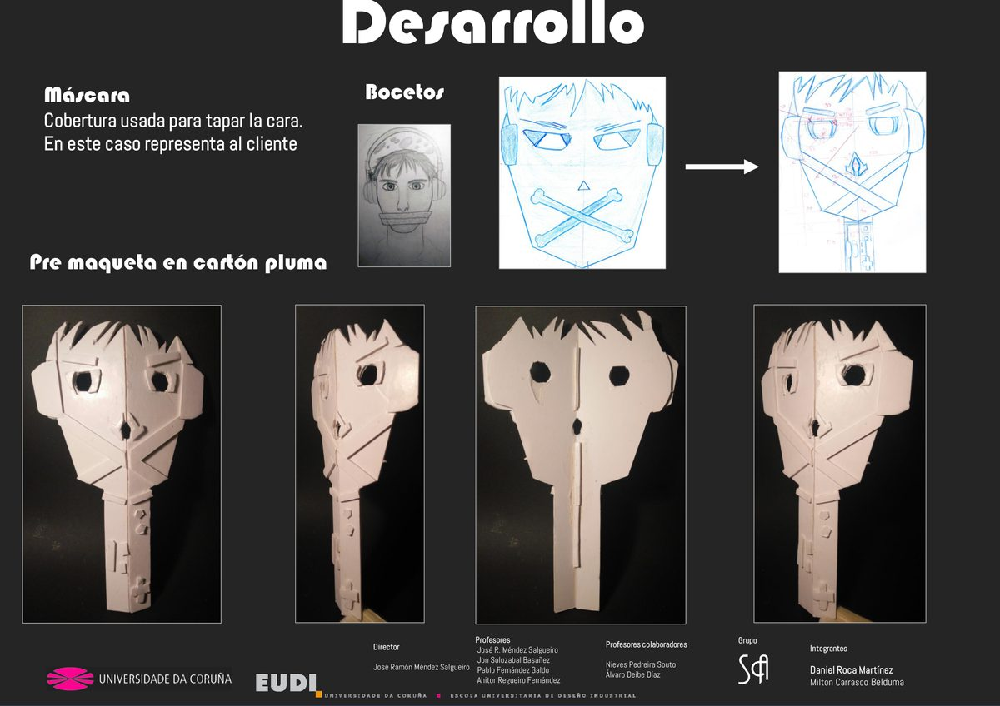
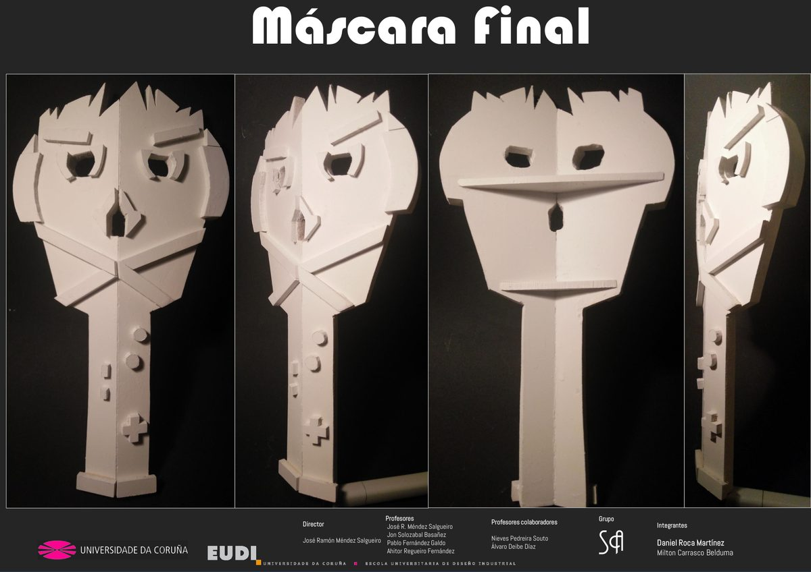
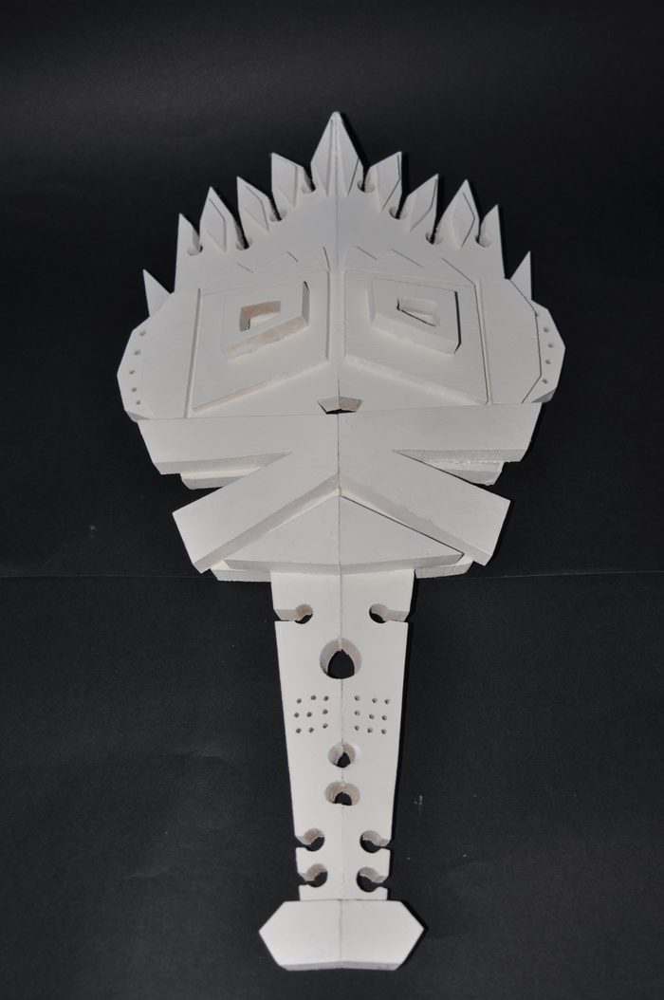
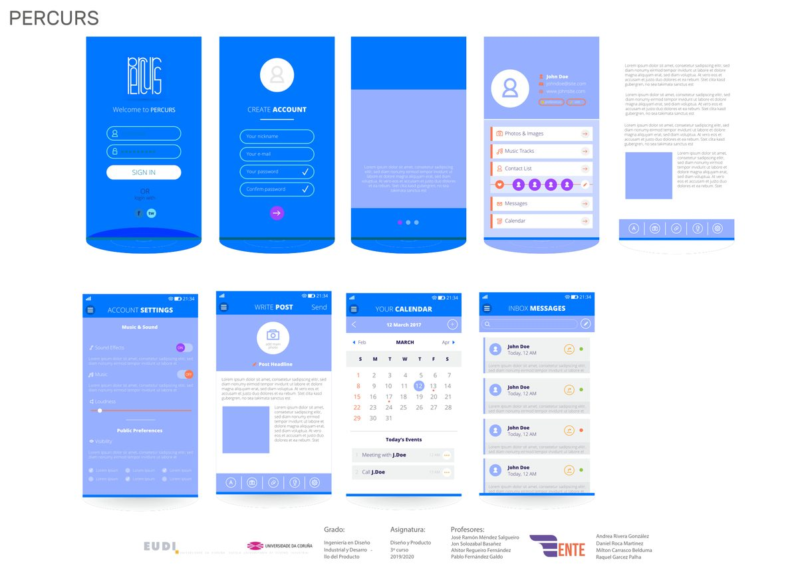
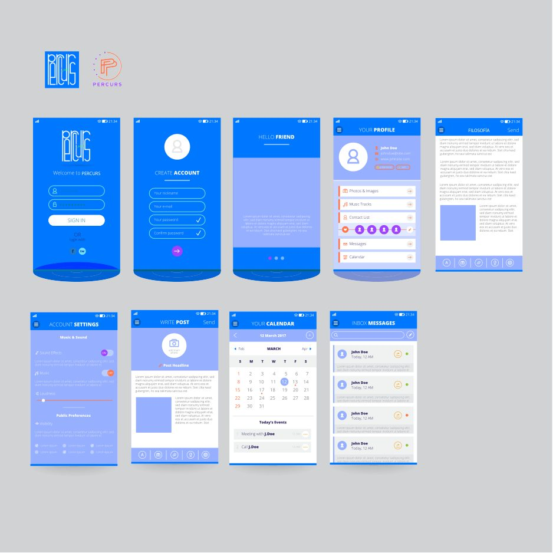
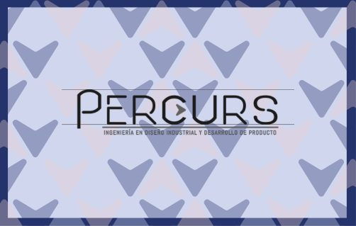
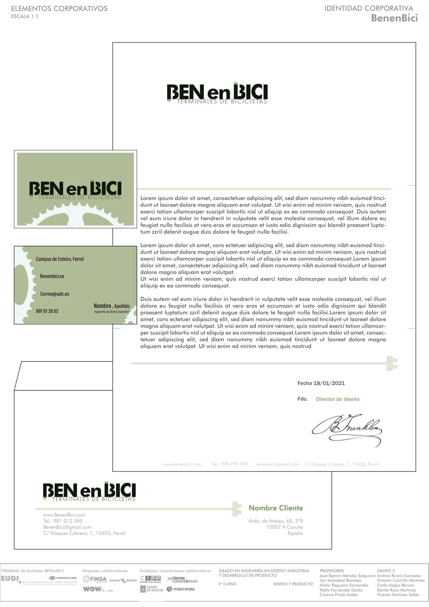

# Otros proyectos de diseño

Más trabajos del Grado en Ingeniería en Diseño Industrial y Desarrollo de Producto (EUDI, Universidade da Coruña). Van de los ejercicios de composición de 1.º a la identidad corporativa y las aplicaciones de 3.º. Los proyectos grandes tienen su propio repositorio: [Barco Xouva](https://github.com/daniroca5/barco-xouva) y [Modelado 3D y CAE](https://github.com/daniroca5/modelado-3d-cae).

## Máscara (Metodología del diseño, 1.º)

El primer proyecto completo con método de diseño. El encargo era una **máscara que representase al cliente**, a partir de sus gustos y planes. El proceso fue:

1. **Estudio del cliente** e imágenes de referencia.
2. **Bocetos** a lápiz y digitales, con varias caras y expresiones.
3. **Premaqueta en cartón pluma** para probar el tamaño, los volúmenes y cómo se sujeta.
4. **Máscara final**, con planos superpuestos y piezas en relieve.
5. **Paneles A3** que cuentan el proceso de principio a fin.

 

## Diseño básico (1.º)

Ejercicios de **lenguaje visual** que sirven de base para todo lo demás:

- **Punto, línea y plano**: composiciones con los elementos mínimos. Aquí, un disco de vinilo hecho solo con circunferencias.
- **Simple y complejo**: una figura descompuesta en formas simples y animada. Se acompañó de un **cómic** con *storyboard* a mano para contar la historia viñeta a viñeta.

  

## Fotografía (Expresión artística, 2.º)

Una serie de fotografías, cada una sobre un concepto y con una semana de plazo. Lo que se trabajó:
- **composición**;
- **luz**, también de noche;
- **color**;
- profundidad de campo.

Los temas fueron un **objeto** (una pinza con rosca), **feminidad** (un frasco de perfume con luz roja), **masculinidad**, **el espacio de la escuela** y **serenidad** (una calle de noche).

  

 

## Identidad corporativa Percurs (Diseño y Producto, 3.º)

Identidad del grupo de diseño **Percurs**, que formamos en clase: logotipo, papelería, tarjetas y paneles expositivos. **Mi parte fue la aplicación móvil**:
- pantallas de registro, cuenta, perfil y ajustes;
- un **calendario** de proyectos;
- **mensajes** entre los miembros del equipo.

Todo con la misma paleta azul y la tipografía de la identidad. Del boceto (*work in progress*) pasé al panel final.

 

## Identidad corporativa BENenBICI (Diseño y Producto)

En el proyecto del **terminal de bicicletas** para una empresa colaboradora, hice propuestas de **identidad visual** del producto: la marca *BENenBICI* aplicada a carta, sobre y tarjetas de visita, con un verde suave y un trazo de bicicleta como recurso gráfico. El módulo del terminal y sus renders están en [Modelado 3D](https://github.com/daniroca5/modelado-3d-cae).

## Herramientas

Photoshop, Illustrator e InDesign (gráfica y maquetación), SolidWorks, Rhino y KeyShot (3D), cámara réflex y lápiz y papel.

---
Daniel Roca Martínez · [Currículum](https://daniroca5.gamer.gd/cv/)
